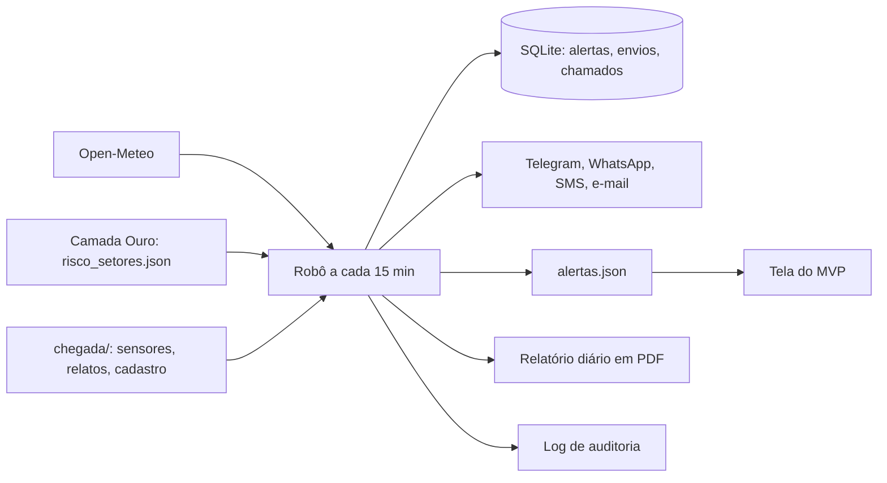

# Encosta Viva: componente de Automação

Robô de software da disciplina **Robotic Process Automation** (Global Solution 2026.2, CitizenTech, 4ES). A cada 15 minutos, ele faz sem intervenção humana o que a Defesa Civil faz à mão em dia de chuva: olha os dados, decide quais setores avisar, manda a mensagem, abre os chamados e registra tudo.

## Integrantes

| Nome completo | RM |
|---|---|
| Ricardo Mattos | 95906 |
| João Gabriel Dias | 99092 |
| Julio Zampieri | 98772 |

## Ficha Técnica do MVP

| Campo | Conteúdo |
|---|---|
| **Produto** | Encosta Viva |
| **Cidadão e território** | Moradores de setores de risco alto e muito alto em encostas urbanas, e agentes da Defesa Civil |
| **Problema** | Quem mora em encosta recebe alertas genéricos por município, tarde demais e sem saber o que fazer |
| **Proposta de valor** | Alerta por setor, com o motivo e o que fazer, em linguagem simples |
| **Componente desta entrega** | Robô em Python: coleta, decisão, alertas, chamados, relatório diário e entrega ao MVP |
| **Fontes de dados** | Open-Meteo (real), camada Ouro do pipeline de Dados, sensores, relatos e cadastro (simulados) |
| **Modelos de IA** | Não usados neste componente: o nível vem de regras explicáveis |
| **URL do MVP** | https://joaogdiass.github.io/encosta-viva-dados/ |
| **Repositório de Automação** | https://github.com/Joaogdiass/encosta-viva-rpa |
| **Repositório de Dados** | https://github.com/Joaogdiass/encosta-viva-dados |
| **Vídeo** | A PREENCHER |
| **Indicadores de impacto** | Antecedência do alerta, moradores avisados por setor, sensores offline, falhas de envio |
| **ODS** | 11 (meta 11.5), 13 (meta 13.1), 9, 10 e 3 |

## Arquitetura



O processo completo está em [docs/processo_to_be.bpmn](docs/processo_to_be.bpmn), que abre em [bpmn.io](https://demo.bpmn.io) e no Camunda Modeler. A imagem está em [assets/fluxo_bpmn.png](assets/fluxo_bpmn.png).

## Estrutura

```
src/         código do robô (src/main.py é a entrada)
docs/        BPMN, roteiro do vídeo e relatório técnico
assets/      imagem do fluxo, tela do MVP e relatório diário de exemplo
logs/        amostras/ tem logs reais, sem dados pessoais
tests/       testes automatizados e evidencias/ com a saída dos cenários
scripts/     demonstrar.py roda os cenários de sucesso, decisão e falha
dados_demo/  cópia dos arquivos do pipeline, para rodar sem o Airflow
```

## Como rodar

Requer Python 3.10 ou mais novo.

```bash
py -m pip install -r requirements.txt
```

```bash
cp .env.example .env
```

Defina `SALT_MORADOR` no `.env`. Sem ele, o robô não roda.

**Testes:**

```bash
py -m pytest tests -v
```

**Cenários de sucesso, decisão e falha** (a saída vai para `tests/evidencias/`):

```bash
py scripts/demonstrar.py
```

**Um período passado**, com os arquivos do Airflow e um relógio simulado de 15 em 15 minutos:

```bash
py src/main.py replay --inicio 2026-11-03T12:00 --fim 2026-11-03T20:30
```

**Um ciclo com o horário real**, consultando o Open-Meteo:

```bash
py src/main.py ciclo
```

**Em operação**, a cada 15 minutos:

```bash
py src/main.py agendar --minutos 15
```

**Relatório de um dia:** o robô gera o do dia anterior na primeira execução de cada dia. Para gerar à mão:

```bash
py src/main.py relatorio --data 2026-11-03
```

### Telegram real (opcional)

Defina `TELEGRAM_BOT_TOKEN` e `TELEGRAM_CHAT_ID` no `.env`. O robô publica uma vez por alerta no grupo do setor, porque o cadastro fictício não tem chat individual. Sem essas variáveis, o canal é simulado como os outros.

### Integração com o MVP

Clone o repositório de Dados ao lado deste e defina no `.env`:

```
CHEGADA_DIR=../encosta-viva-dados/chegada
OURO_ORIGEM=../encosta-viva-dados/mvp/dados/risco_setores.json
MVP_DADOS_DIR=../encosta-viva-dados/mvp/dados
ENCOSTA_DADOS_DIR=../encosta-viva-dados
```

O robô passa a gravar `mvp/dados/alertas.json`, e a tela mostra os alertas enviados e o nível mais recente de cada setor. `ENCOSTA_DADOS_DIR` gera as leituras de hoje com o simulador do pipeline, no lugar do MQTT do robô físico.

## O que o robô decide

| Situação | Ação |
|---|---|
| O nível subiu | Envia alerta a cada morador do setor. Em Alerta ou acima, abre chamado de vistoria |
| O nível ficou igual | Não reenvia |
| O nível caiu, mas não para Observação | Atualiza o estado, sem mensagem |
| O nível caiu para Observação | Envia mensagem de encerramento |
| Dado incompleto e nível calculado menor | Mantém o nível: dado faltando não encerra alerta |
| Sensor sem leitura há mais de 30 min | Abre chamado de manutenção e usa só os dados de chuva |
| Bateria abaixo de 20% | Abre chamado de manutenção |

A chave de idempotência é `setor + tipo + nível + janela de 6 h + episódio`. O episódio aumenta a cada encerramento, para um risco novo na mesma janela não ser silenciado.

## LGPD e segurança

- O nome e o telefone do cadastro não são guardados: só `morador_hash` (SHA-256 com salt, igual ao da camada Prata), setor e canal.
- O log só registra hash parcial e passa por um filtro que remove telefone, nome e token.
- `alertas.json` só tem dados agregados por setor.
- Arquivo de cadastro inválido não é copiado para a quarentena: fica só o motivo.
- Salt e token ficam no `.env`, fora do repositório.

## IA responsável

O nível é uma sugestão explicada pelos fatores. Quem decide remover moradores é a Defesa Civil, e todas as mensagens dizem isso.

## Limitações

- WhatsApp, SMS e e-mail são simulados, e o cadastro é fictício. Sem token, o Telegram também é simulado.
- O Telegram foi testado contra um servidor falso, e não contra a API real.
- Sensores, relatos e eventos de chuva extrema vêm do simulador do pipeline.
- Os limiares em [src/encosta_rpa/motor.py](src/encosta_rpa/motor.py) são ilustrativos e precisam ser calibrados com PPDC, CEMADEN e IPT.
- A chuva do Open-Meteo vem de uma grade maior que uma encosta.
